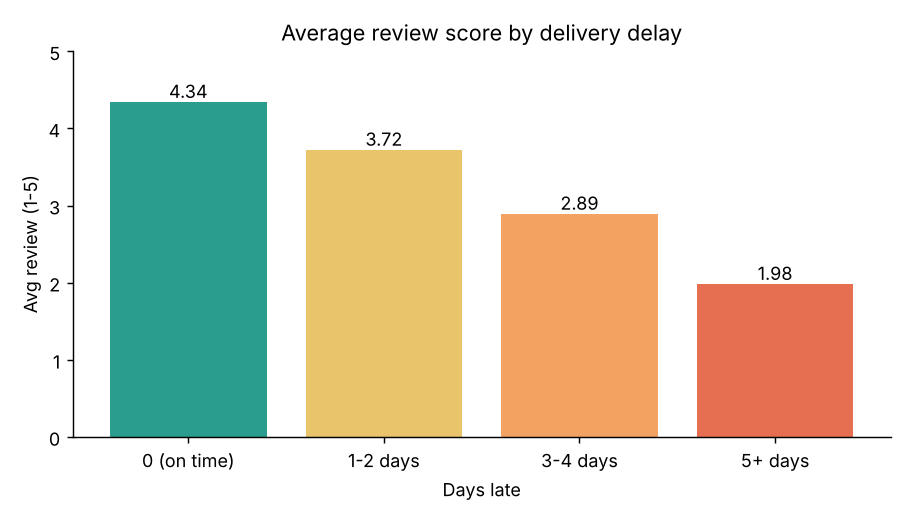
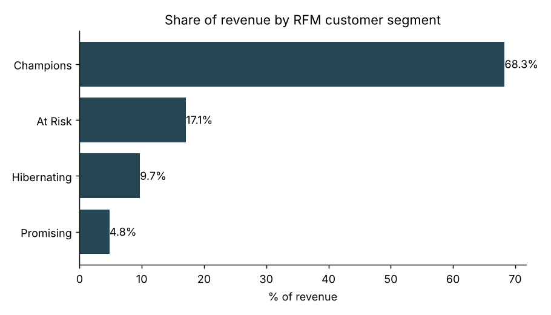

# E-commerce Customer & Delivery Analytics

End-to-end analytics project: raw data → SQL data models → customer segmentation → business recommendations → Power BI dashboard.

> **Status: v0.1 – built on a synthetic dataset** (generated by `python/01_generate_data.py`, fixed seed, fully reproducible).
> v1.0 (in progress) moves the same pipeline to the public **Olist e-commerce dataset** (100k real orders) on **Snowflake**, with a **Power BI** dashboard.

## Business questions
1. How do late deliveries affect customer satisfaction?
2. Which regions have delivery problems?
3. Which customers drive revenue, and who is at risk of leaving? (RFM segmentation)
4. Which acquisition channels bring customers who buy again?

## Project structure
| Layer | Folder | What it shows |
|---|---|---|
| Analytics Engineering | `sql/01_staging.sql` | raw → staging, de-duplication, derived columns, data quality tests |
| Data Analysis | `sql/02_marts.sql` | KPI marts: monthly KPIs, delay vs review, region performance |
| Marketing & Growth | `sql/03_customer_rfm.sql` | RFM segmentation with window functions (NTILE), repeat-purchase rate by channel |
| Business Analysis | `docs/business_recommendations.md` | KPI definitions + recommendations for decision-makers |

## Key findings (v0.1, synthetic data)
- **Late deliveries hurt reviews sharply:** on-time orders average **4.34/5**; orders 5+ days late average **1.98/5**, and 76% of them get a bad review (1–2 stars).
- **Two regions have a delivery problem:** Occitanie (58% late) and Nouvelle-Aquitaine (60% late), versus 29–33% elsewhere, and they have the lowest review scores.
- **Revenue is concentrated:** "Champions" are about a third of customers but **68% of revenue**; "At Risk" customers still hold 17% of revenue.




## How to run
```bash
pip install pandas numpy matplotlib
python python/01_generate_data.py   # creates data/raw/*.csv
python python/02_run_pipeline.py    # loads into SQLite, runs SQL models + data tests, exports marts and charts
```
Mart tables are exported to `data/marts/*.csv`, ready to load into Power BI.

## Tools
SQL (CTEs, window functions) · Python (pandas, NumPy, matplotlib) · SQLite (v0.1) → Snowflake (v1.0) · Power BI (v1.0)

## Roadmap
- [x] v0.1 – pipeline, SQL models, data tests, RFM, charts (synthetic data)
- [ ] v1.0 – Olist dataset on Snowflake
- [ ] dbt models + tests
- [ ] Power BI dashboard (Executive / Customers / Delivery)
